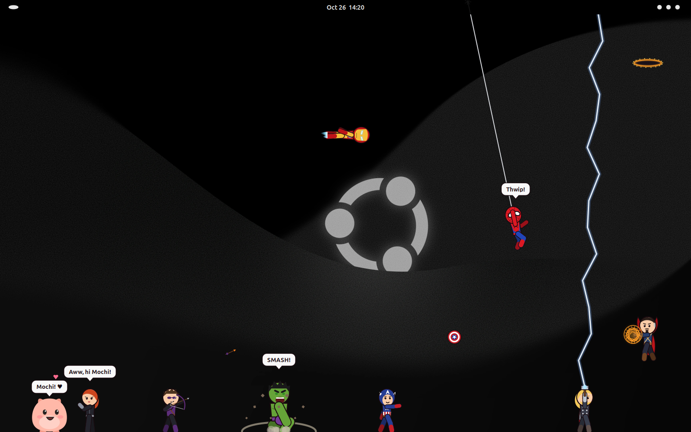

# Avengers Pets


Little desktop pets that live on your screen: Spider-Man, Iron Man, Captain America, Hulk, Thor, Black Widow, Hawkeye, Doctor Strange and Mochi. They wander, fly, swing on webs, throw shields and hammers, open portals, chat when they meet, and knock each other around, all on top of your other windows.

Works on **Windows 10/11** and **Linux (GNOME)**. Fan-made for fun. The Marvel characters belong to Marvel.

- [Install on Windows](#install-on-windows)
- [Install on Linux](#install-on-linux)
- [How to play](#how-to-play)
- [Meet the team](#meet-the-team)
- [What's in this repo](#whats-in-this-repo)

## Install on Windows

Works on Windows 10 (version 1809 or newer) and Windows 11. Nothing extra to install, and no administrator rights needed.

1. **Download** [avengers-pets-windows.zip](https://github.com/Krish0703-irl/avengers-pets/raw/main/downloads/avengers-pets-windows.zip).
2. **Unzip it:** right-click the zip in your Downloads folder and choose **Extract All**, then **Extract**.
3. **Run the installer:** open the extracted **Avengers Pets** folder and double-click **Install.bat**.
4. **If Windows warns you** with "Windows protected your PC", click **More info**, then **Run anyway**. This appears for any script downloaded from the internet.
5. **Answer one question:** type `y` and press Enter if you want the pets to start every time you sign in to Windows, or just press Enter to skip.
6. **Done.** The heroes come out right away, and the panel for choosing who stays opens on the first run.

The installer copies the app to `%LOCALAPPDATA%\AvengersPets` and adds **Avengers Pets** shortcuts to your Start menu and desktop. Open that shortcut any time to bring back the panel.

**Try it without installing:** in the extracted folder, double-click **Start Avengers Pets.bat** instead.

**Uninstall:** double-click **Uninstall.bat** in the extracted folder. It puts the heroes away and removes the app, its shortcuts and its settings.

**If the heroes don't show up:** double-click **Avengers Pets (show errors).bat**. It keeps a window open and shows what went wrong. Work and school computers sometimes block PowerShell scripts; the message will say so.

## Install on Linux

Works on Linux with the GNOME desktop, such as Ubuntu. It needs `gjs`, which comes with GNOME. If it's missing:

```bash
sudo apt install gjs
```

**Option 1: one command.** This downloads and installs everything:

```bash
curl -fsSL https://raw.githubusercontent.com/Krish0703-irl/avengers-pets/main/linux/install.sh | sh
```

To also start the pets every time you log in:

```bash
curl -fsSL https://raw.githubusercontent.com/Krish0703-irl/avengers-pets/main/linux/install.sh | sh -s -- --autostart
```

**Option 2: from the zip.**

1. **Download** [avengers-pets-linux.zip](https://github.com/Krish0703-irl/avengers-pets/raw/main/downloads/avengers-pets-linux.zip) and unzip it.
2. **Open a terminal** in the extracted **Avengers Pets** folder.
3. **Run the installer:**

   ```bash
   sh install.sh
   ```

4. **Answer one question:** type `y` if you want the pets to start every time you log in.
5. **Done.** The heroes come out right away.

**Option 3: from a clone of this repo.**

```bash
git clone https://github.com/Krish0703-irl/avengers-pets.git
cd avengers-pets
sh linux/install.sh
```

The installer copies the app to `~/.local/share/avengers-pets/app` and adds **Avengers Pets** to your app menu. Open it from the app menu any time to bring back the panel.

**Uninstall:**

```bash
sh linux/uninstall.sh
```

Or run `sh uninstall.sh` from the zip folder. It puts the heroes away and removes the app, its menu entry, its log-in entry and its settings.

**Run without installing:**

```bash
gjs -m avengers-pets.js
```

## How to play

- **Click** a hero for a trick: Spider-Man flips, Cap throws his shield, Thor calls lightning, Doctor Strange raises his shields, and Mochi gets pats.
- **Drag** a hero to pick them up, and let go to throw them.
- **Right-click** a hero for their own moves, like **Fire repulsors**, **Smash!** or **Portal-prank someone**. The same menu has **Stay put**, **Send home**, **Choose heroes…** and **Put everyone away**.
- **Choose who stays** in the panel, with a switch for each hero. Open Avengers Pets again while it's running to bring the panel back.

Clicks pass straight through to your windows everywhere except on the heroes themselves.

## Meet the team

| | | |
|:---:|:---:|:---:|
| <br>**Spider-Man**<br>Swings on webs, climbs the screen edges, hangs upside down | <br>**Iron Man**<br>Flies on jet boots, fires repulsor beams | <br>**Captain America**<br>Throws his shield; it bounces off the screen edges and comes back |
| <br>**Hulk**<br>Leaps, roars, and smashes the ground with a shockwave | <br>**Thor**<br>Flies with Mjolnir, calls down lightning | <br>**Black Widow**<br>Flips, slide-tackles, uses Widow's Bites |
| <br>**Hawkeye**<br>Shoots arrows, some of them explosive | <br>**Doctor Strange**<br>Floats, casts shields, portal-pranks the others | <br>**Mochi**<br>Waddles, hops, naps, and loves pats |

## They get in each other's way

- Cap's shield and Thor's hammer knock over whoever they hit.
- Iron Man's beam and Hawkeye's exploding arrows send heroes flying.
- Hulk's landing shockwave throws everyone nearby into the air. Hit Hulk, and he gets angry.
- Doctor Strange's shields block thrown weapons, and his portals drop other heroes in from the top of the screen.
- When two heroes meet they stop and chat ("Hi Mr. Stark!" / "Kid. We talked about this.").

## On the desktop

The pets at their real size on an Ubuntu desktop.



## What's in this repo

| Path | What it is |
|---|---|
| `avengers-pets.js` | The app for Linux (GNOME): all nine heroes and the panel, in one file. |
| `windows/AvengersPets.ps1` | The app for Windows: the same heroes and panel, in one file. |
| `windows/Install.bat`, `windows/Uninstall.bat` | The Windows installer and uninstaller (they run `install.ps1` and `uninstall.ps1`). |
| `windows/Start Avengers Pets.bat` | Starts the Windows app without installing. |
| `linux/install.sh`, `linux/uninstall.sh` | The Linux installer and uninstaller. |
| `downloads/` | Ready-to-share zips for Windows and Linux. |
| `images/` | The pictures in this README, and the app icon. |
| `spidey.js`, `pocket-pet.js` | The earlier standalone Spider-Man and Mochi pets for Linux. |
| `pocket-pet.html` | Mochi as a web page you can open in any browser. |
| `spidey-pet.zip`, `spidey-pet-windows.zip` | The earlier standalone Spider-Man, packaged for Linux and Windows. |

## How it works

Each app is one see-through, always-on-top window covering the screen above the taskbar, with every hero drawn into it about 30 times a second. Only the pixels where a hero is drawn catch the mouse, so the rest of your screen keeps working.

- **Linux:** GNOME JavaScript (`gjs`) with GTK 3 and Cairo. It runs under XWayland so the window can stay on top and position itself on Wayland.
- **Windows:** a PowerShell script that compiles a small C# WinForms program on the fly, so it needs nothing beyond Windows itself.

The heroes share one body rig (head, torso, two-part arms and legs) posed by joint angles, plus a simple state machine each for walking, flying, swinging, throwing and so on.

For development, the Linux app can render every pose to an image and run a quick simulation without a display:

```bash
gjs -m avengers-pets.js --snapshot poses.png
gjs -m avengers-pets.js --simulate 10
```

## Every pose


