# Avengers Pets

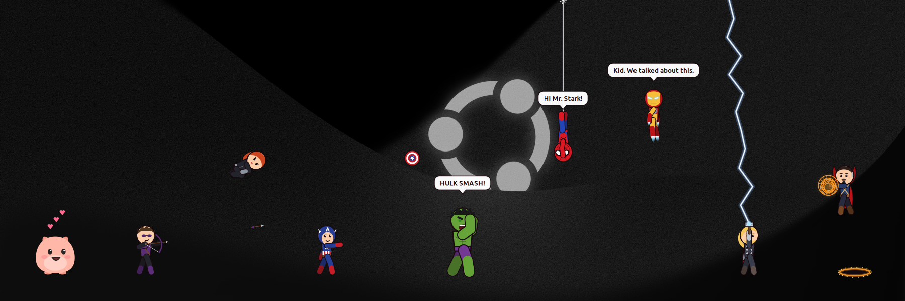

Little desktop pets that live on your screen: Spider-Man, Iron Man, Captain America, Hulk, Thor, Black Widow, Hawkeye, Doctor Strange and Mochi. They wander, fly, swing on webs, throw shields and hammers, open portals, chat when they meet, and knock each other around.

Fan-made for fun. The Marvel characters belong to Marvel.

## Meet the team

| | | |
|:---:|:---:|:---:|
| 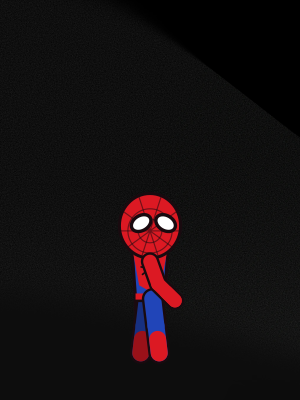<br>**Spider-Man**<br>Swings on webs, climbs the screen edges, hangs upside down | 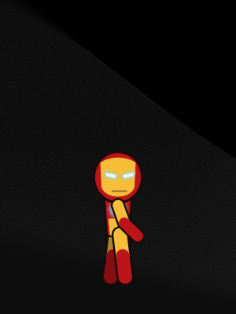<br>**Iron Man**<br>Flies on jet boots, fires repulsor beams | 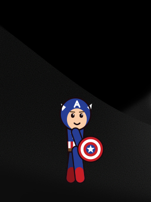<br>**Captain America**<br>Throws his shield; it bounces off the screen edges and comes back |
| 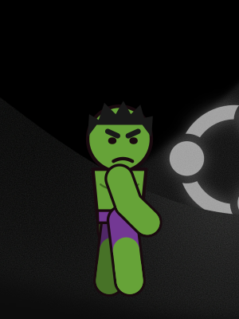<br>**Hulk**<br>Leaps, roars, and smashes the ground with a shockwave | 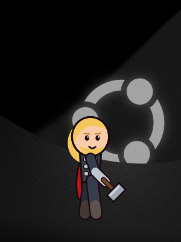<br>**Thor**<br>Flies with Mjolnir, calls down lightning | 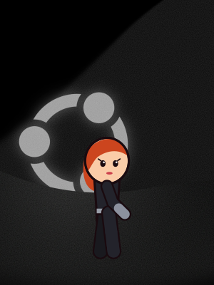<br>**Black Widow**<br>Flips, slide-tackles, uses Widow's Bites |
| 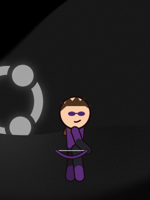<br>**Hawkeye**<br>Shoots arrows, some of them explosive | 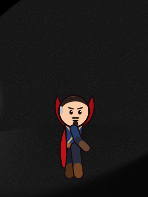<br>**Doctor Strange**<br>Floats, casts shields, portal-pranks the others | 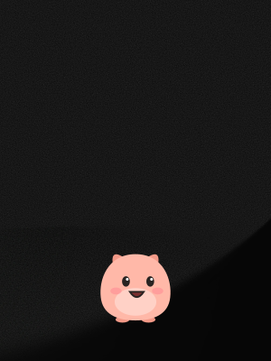<br>**Mochi**<br>Waddles, hops, naps, and loves pats |


## They get in each other's way

- Cap's shield and Thor's hammer knock over whoever they hit.
- Iron Man's beam and Hawkeye's exploding arrows send heroes flying.
- Hulk's landing shockwave throws everyone nearby into the air. Hit Hulk, and he gets angry.
- Doctor Strange's shields block thrown weapons, and his portals drop other heroes in from the top of the screen.
- When two heroes meet they stop and chat ("Hi Mr. Stark!" / "Kid. We talked about this.").


## Every pose

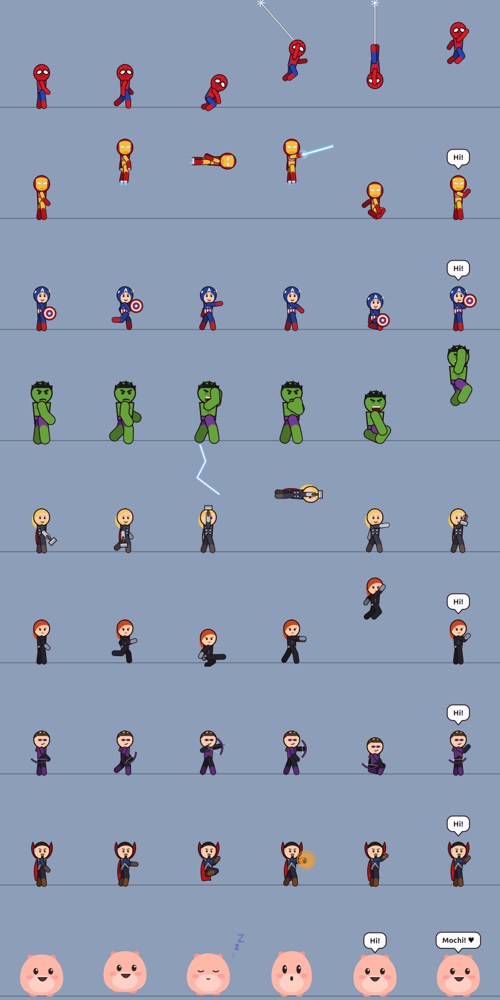

## What's here

| File | What it is |
|---|---|
| `avengers-pets.js` | The main app (Linux, GNOME). All nine pets with a panel to choose who stays. |
| `spidey.js` | The earlier standalone Spider-Man pet (Linux, GNOME). |
| `pocket-pet.js` | The earlier standalone Mochi pet (Linux, GNOME). |
| `pocket-pet.html` | Mochi as a web page you can open in any browser. |
| `spidey-pet.zip` | Spider-Man packaged with an installer, for sharing with Linux users. |
| `spidey-pet-windows.zip` | Spider-Man for Windows 10/11. Unzip and double-click `Start Spidey.bat`. |

## Run it (Linux with GNOME)

Needs `gjs`, which comes with GNOME (`sudo apt install gjs` if it's missing).

```bash
gjs -m avengers-pets.js
```

Run it again while it's open to bring back the panel where you switch pets on and off.

## Play

- **Click** a pet for a trick.
- **Drag** to pick one up and toss it.
- **Right-click** for that pet's own moves, to make it stay put, send it home, or put everyone away.
